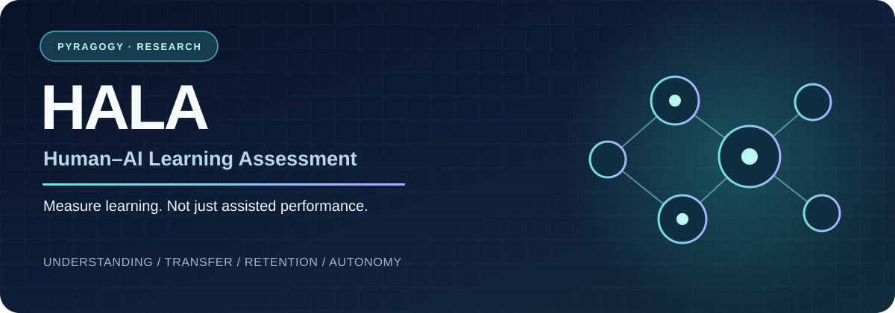
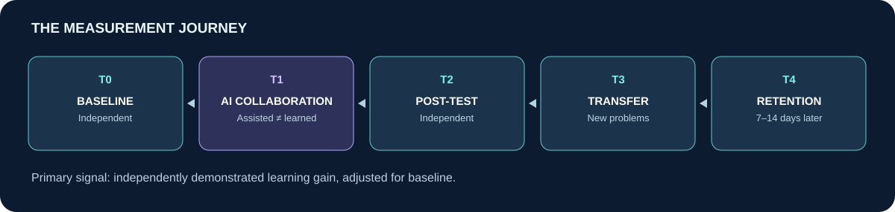

<div align="center">



**What do we learn with AI — and what stays with us afterwards?**

[](CHANGELOG.md)
[](LICENSE)
[](LICENSING.md)

[Read the proposal](proposal/submission/hala_pisa_rdi_2026_final_gaps.pdf) · [Explore the idea](#the-idea) · [Try the prototype](#try-the-prototype) · [Help it-grow](#help-hala-grow)

</div>

## Welcome to HALA

**HALA explores how to recognise learning when AI is part of the process.** It brings together a research proposal, a proposed study design and a small software prototype.

Created by **Fabrizio Terzi**, within [Pyragogy](https://pyragogy.org), HALA is currently a personal research project developed with AI assistance. There is no established research team or institutional partnership. Sharing the work is a way to make the ideas useful, invite thoughtful criticism and meet people who would like to help.

**Current stage:** an early research prototype using synthetic examples. No learner study has been conducted, and the assessment method has not been validated.

## The idea

AI can help us explain a concept, solve a problem or write a convincing answer. HALA asks what happens next: can we explain the idea ourselves, apply it to a different problem and remember it later?

The proposed study compares three ways of learning:

| Approach | Learning experience |
| :--- | :--- |
| **A · Without AI** | Learning resources and self-checks |
| **B · AI tutor** | Explanations and guided support |
| **C · Critical AI collaborator** | Questions, alternative views and challenges to reasoning |

The hypothesis is that critical interaction with AI *may* support deeper learning than explanatory assistance alone. The study must also be able to show that this hypothesis is wrong.



Learning would be assessed independently before and after the session, then through unfamiliar problems and a follow-up 7–14 days later. The main planned comparison is post-session independent performance in C versus B, adjusted for baseline performance. Transfer and retention are additional outcomes.

A separate [OECD/PISA research extension](research/PISA_RDI_CONVERSATIONAL_ASSESSMENT_EXTENSION.md) explores what evidence an AI-mediated conversation might provide about proficiency. It is a different research question; conversational observations are not calibrated proficiency scores.

## The submission edition

**Version 1.0.0** records the proposal and supporting materials prepared for the OECD submission. The author confirms that the proposal was sent on **9 October 2026**.

**[Read the submitted proposal · PDF, 2 pages](proposal/submission/hala_pisa_rdi_2026_final_gaps.pdf)**

The original PDF is archived unchanged. Its file history, checksum and the earlier preview-digest discrepancy are documented in the [submission archive](proposal/submission/README.md). No OECD receipt, acceptance or endorsement is recorded.

The repository is currently private. Making it public and writing a blog post are separate next steps. Version 1 describes this research snapshot; a GitHub release has not yet been published.

## What is here today

| Available | Still to establish |
| :--- | :--- |
| Research questions and a proposed study protocol | Independent scientific review |
| Draft assessment tasks and scoring approach | Reliable, fair measures of learning |
| A Python prototype with synthetic examples | A fully verified deployment for real use |
| Submission PDF and documented project history | Ethics approval and a study with learners |

The proposed **Epistemic Quality Index (EQI)** is an idea to investigate, not a validated instrument. The prototype can help check software behaviour; it cannot establish that someone has learned.

## Help HALA grow

You do not need to join a formal team to contribute. A useful question, a clearer example or an honest account of how you learn with AI can help shape the next step.

- **Read and challenge:** which claims need stronger evidence? What would convince you?
- **Make it clearer:** suggest better explanations, examples or accessible wording.
- **Try the software:** report confusing steps or reproducible problems using synthetic data.
- **Bring experience:** share perspectives from teaching, learning, assessment or software development.

With repository access, start with [Issues](../../issues) or the short [contribution guide](CONTRIBUTING.md). Otherwise, visit [Pyragogy](https://pyragogy.org). There are no existing partnerships implied by this invitation.

Please keep personal learner records, private conversations and credentials out of the repository.

## Try the prototype

On Linux/macOS with Python 3.10+, from the repository root:

```bash
python -m prototype.separated_assessment.launch_local
```

Open **http://127.0.0.1:8766** and stop the demo with **Ctrl+C**. For a remote server, follow the [SSH tunnel instructions](prototype/separated_assessment/INTEGRATION.md).

The demo uses synthetic data and a scripted AI stand-in. Its two processes run under the same user account; it does not provide operating-system isolation. Its retention step occurs in the same session, so it does not test delayed learning. Use it for local exploration only.

For software checks:

```bash
python -m unittest discover -s prototype/tests -v
python -m compileall -q prototype
python prototype/analyse.py prototype/fixtures/synthetic_scores.csv
```

GitHub Actions remains disabled. The latest review environment blocked Unix sockets, leaving two socket tests and the gateway integration setup unverified there. Full supported-host testing and launcher checks remain tracked in [issue #3](../../issues/3). Earlier agent-reported test results are recorded in the [repository review](governance/REPOSITORY_REVIEW_2026-10-10.md).

[Prototype guide](prototype/README.md) · [Demo instructions](prototype/separated_assessment/INTEGRATION.md) · [Assessment worker](prototype/separated_assessment/README.md)

## Explore further

| Start here | What you will find |
| :--- | :--- |
| [Study protocol](research/PROTOCOL_V1.md) | Study design, comparison groups and outcomes |
| [Hypotheses](research/HYPOTHESES.md) · [Analysis plan](research/ESTIMANDS_AND_ANALYSIS.md) | Predictions and how they could be tested |
| [Measurement](assessment/MEASUREMENT.md) · [Example task blueprint](assessment/ITEM_BLUEPRINT.md) | What independent assessment would need to measure |
| [Roadmap](ROADMAP.md) | Future work and evidence needed |
| [Claim register](research/CLAIM_REGISTER.md) · [Self-audit](research/ADVERSARIAL_AUDIT.md) | What is supported and what remains uncertain |
| [Ethics](governance/ETHICS.md) · [Security](SECURITY.md) | Requirements before working with real participants |
| [Prior work](research/PRIOR_WORK.md) | Intellectual foundations and their limits |
| [Repository review](governance/REPOSITORY_REVIEW_2026-10-10.md) | Technical review and publication preparation |

AI-assisted development and agent reviews are documented in the [collaboration record](governance/HUMAN_AI_RESEARCH_COLLABORATION.md). They are software and drafting support, not independent human scientific review.

## Reuse and attribution

Original code is licensed under **AGPL-3.0-only**. Original text and figures, including the HALA proposal PDF, are licensed under **CC BY-SA 4.0**. Third-party works retain their own rights. See [license scope](LICENSING.md) for details.

To cite this edition, use [CITATION.cff](CITATION.cff). The archived PDF reflects the submission date; the repository licenses were approved the following day.

---

**HALA · Pyragogy**  
*A question worth exploring together: what remains when the AI is gone?*
